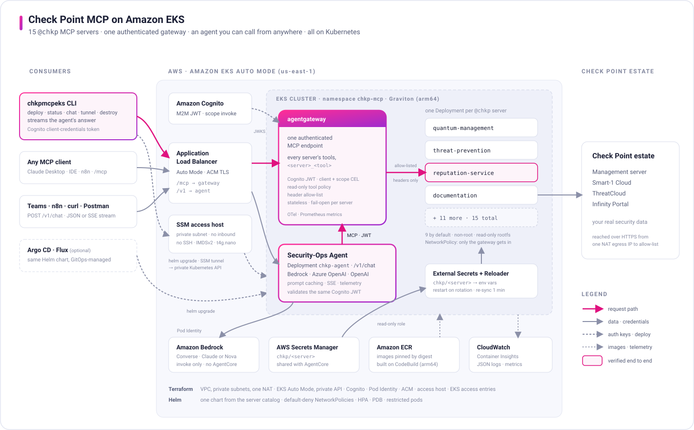
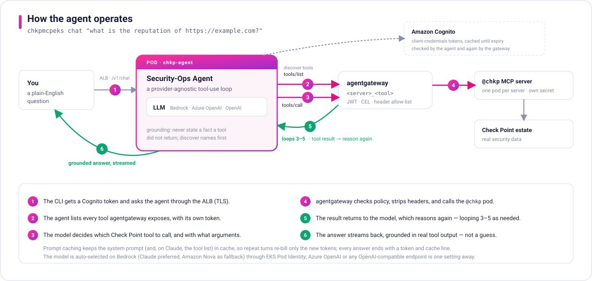
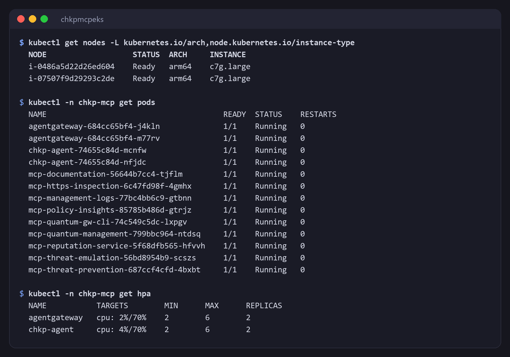
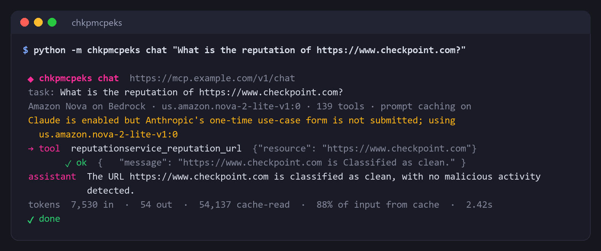

# Check Point MCP on Amazon EKS


<br>


A **reference architecture** for running Check Point's Model Context Protocol servers on **Amazon EKS**. It deploys the 15 `@chkp` MCP servers behind **one authenticated MCP gateway** ([agentgateway](https://agentgateway.dev)) and ships a **security-operations agent** that reasons over your estate by calling those tools through the gateway. It is the EKS counterpart of [checkpoint-mcp-on-aws-agentcore](https://github.com/alshawwaf/checkpoint-mcp-on-aws-agentcore): same servers, same credentials, no Bedrock AgentCore.

<p align="center">
  <a href="docs/img/architecture.svg" title="Open the full-size diagram">
    <picture>
      <source media="(prefers-color-scheme: dark)" srcset="docs/img/architecture-dark.svg">
      
    </picture>
  </a>
</p>

One cross-platform CLI does everything (`python -m chkpmcpeks deploy | status | chat | creds | destroy`) on Windows, macOS and Linux. No local Docker or AWS CLI is needed. Jump to the **[Quick Start](#quick-start)**.

---

## What you get

### 1 · Check Point MCP servers, one Deployment each

Every published `@chkp` server we host runs as its own hardened Kubernetes Deployment, built from the **version-pinned npm package** and referenced **by digest**. `deploy` brings up the **same 9 as the AgentCore project**: the six management-shaped servers, `reputation-service`, `threat-emulation` and `documentation`. The other six are one flag away. See the [server catalog](#server-catalog).

### 2 · One MCP gateway

**agentgateway** aggregates every server into **one authenticated streamable-HTTP endpoint**, with tools namespaced `<server>_<tool>` (for example `reputationservice_…`, `quantummanagement_show_hosts`). It validates Amazon Cognito JWTs, enforces client, scope and **read-only tool policy** with CEL, keeps client headers away from the servers (**header allow-list**), serves the rest of the catalog when one server fails, and exports OpenTelemetry and Prometheus metrics.

### 3 · An agent you can call from anywhere

The agent is an HTTP service in the cluster (`POST /v1/chat`, JSON or a streamed SSE response). It discovers the gateway's tools, reasons with an LLM, calls the Check Point tools **through the gateway**, and answers from real tool output. The LLM is **pluggable**:

- **Amazon Bedrock** by default, model invocation only, with EKS Pod Identity. Claude is preferred and Amazon Nova is the fallback, chosen automatically.
- **Claude through the Anthropic API** with your own API key and its spend limit: `deploy --llm-provider anthropic` (default model `claude-opus-5-5`, change it with `--llm-model`).
- **Azure OpenAI**, or any **OpenAI-compatible** endpoint, by setting.

To switch the agent to your Anthropic API key, put the key in the `[llm]` section of `chkp-credentials.env` and redeploy. The choice is remembered for later deploys.

```bash
python -m chkpmcpeks creds apply
python -m chkpmcpeks deploy --llm-provider anthropic --skip-build
```

Prompt caching, streaming and token telemetry are built in. The CLI, curl, Postman, n8n and Teams flows call the same authenticated endpoint.

<p align="center">
  <a href="docs/img/agent-flow.svg" title="Open the full-size diagram">
    <picture>
      <source media="(prefers-color-scheme: dark)" srcset="docs/img/agent-flow-dark.svg">
      
    </picture>
  </a>
</p>

### 4 · EKS best practice, end to end

| | |
|---|---|
| **Compute** | EKS Auto Mode with a Graviton (arm64) NodePool. AWS runs nodes, the ALB controller, the Pod Identity agent, CoreDNS and the CNI. |
| **Ingress** | Application Load Balancer from the Auto Mode controller, ACM TLS, one hostname for `/mcp` and `/v1`. |
| **Identity** | EKS Pod Identity, one IAM role per workload. MCP server pods hold **no** AWS credentials. |
| **Secrets** | External Secrets Operator syncs the **same `chkp/<server>` secrets** the AgentCore project uses. Reloader restarts a pod when its secret rotates. |
| **Network** | Private subnets, default-deny NetworkPolicies (only the gateway reaches a server), one NAT egress IP to allow-list on management servers. |
| **Pods** | Restricted Pod Security Standard, non-root, read-only root filesystem, all capabilities dropped, requests and limits, HPA, PDB. |
| **Supply chain** | Images by digest, immutable tags, ECR scan on push, `npm install --ignore-scripts`, GitHub Actions pinned by SHA. |
| **Observability** | CloudWatch Container Insights and JSON logs by default, Prometheus metrics and OTLP tracing ready. |
| **Delivery** | Terraform for AWS, one Helm chart for the workloads (GitOps-ready), images built on CodeBuild or GitHub Actions (OIDC). |
| **Teardown** | `destroy` removes every billable resource in the right order and proves it with a tag scan. |

<p align="center"></p>

Why EKS rather than Bedrock AgentCore, and when AgentCore is still the better pick: **[docs/why-eks-vs-agentcore.md](docs/why-eks-vs-agentcore.md)**.

---

## Quick Start

### 1. Prerequisites

| Tool | Windows | macOS | Linux |
|---|---|---|---|
| Python ≥ 3.10, Git | python.org, git-scm.com | `brew install python git` | your package manager |
| Terraform ≥ 1.10 | `scoop install terraform` | `brew install hashicorp/tap/terraform` | [install](https://developer.hashicorp.com/terraform/install) |
| Helm, kubectl | `scoop install helm kubectl` | `brew install helm kubectl` | [helm](https://helm.sh/docs/intro/install/), [kubectl](https://kubernetes.io/docs/tasks/tools/) |

AWS credentials come from the standard chain: profile, SSO, environment variables or an instance role. `--profile` works on every command. No AWS CLI and no local Docker are needed: images build on AWS CodeBuild, and the kubeconfig authenticates through the CLI itself.

### 2. Get the code

```bash
git clone https://github.com/alshawwaf/checkpoint-mcp-on-eks.git
```

```bash
cd checkpoint-mcp-on-eks
```

```bash
python -m venv .venv
```

Activate it: `.venv\Scripts\Activate.ps1` on Windows, or `source .venv/bin/activate` on macOS and Linux. Then install:

```bash
pip install -e ".[mcp]"
```

### 3. Preflight (read-only)

```bash
python -m chkpmcpeks doctor
```

It checks the tools, your AWS identity, which `chkp/<server>` secrets already exist, and which Bedrock models your account can invoke.

### 4. Deploy

```bash
python -m chkpmcpeks deploy
```

It asks before creating billable resources and takes about 30–40 minutes the first time. It builds the images, applies Terraform (VPC, EKS Auto Mode, Cognito, Pod Identity, ACM), installs External Secrets and Reloader, deploys the Helm chart, waits for the ALB, and then verifies: an unauthenticated request must be refused, and `tools/list` must work through the gateway. Every step is idempotent, so re-run it after any interruption.

Without a domain, the ALB serves a self-signed certificate. Desktop MCP apps and n8n's MCP node need a publicly trusted one, so add `--domain mcp.example.com`. See [serve it on your own domain](docs/runbooks/custom-domain.md) for the DNS records.

### 5. Credentials

If you already use the AgentCore project, your `chkp/<server>` secrets are reused as they are. Otherwise:

```bash
python -m chkpmcpeks creds template
```

```bash
python -m chkpmcpeks creds apply
```

Fill in `chkp-credentials.env` between the two commands. It is gitignored. See [the credentials runbook](docs/runbooks/credentials.md).

### 6. Ask the agent

```bash
python -m chkpmcpeks chat "what is the reputation of https://example.com?"
```

The answer streams, every tool call is shown, and each run ends with a token and cache line.

<p align="center"></p>

Check the whole stack at any time with `python -m chkpmcpeks status`. It shows each server's tool count through the gateway; see [the CLI example](examples/cli/README.md#check-the-stack).

### 7. Tear down

```bash
python -m chkpmcpeks destroy
```

It removes everything this stack created, then scans for leftovers. The `chkp/<server>` credential secrets are always kept.

---

## Server catalog

| Server (`@chkp/…-mcp`) | Pinned | Credentials (own `chkp/<server>` secret) | Default |
|---|---|---|---|
| `quantum-management` | 1.4.7 | `MANAGEMENT_HOST` / `MANAGEMENT_PORT` / `API_KEY` (or `S1C_URL`) | ✅ |
| `management-logs` | 1.4.6 | management fields | ✅ |
| `threat-prevention` | 1.5.4 | management fields | ✅ |
| `https-inspection` | 1.4.6 | management fields | ✅ |
| `policy-insights` | 0.3.5 | management fields | ✅ |
| `quantum-gw-cli` | 1.4.8 | management fields (authenticates to the management server, not Gaia) | ✅ |
| `reputation-service` | 1.3.1 | `API_KEY` (ThreatCloud) | ✅ |
| `threat-emulation` | 1.3.1 | `API_KEY` (ThreatCloud). Hash and URL lookups; no local file upload | ✅ |
| `documentation` | 1.4.6 | `CLIENT_ID` / `SECRET_KEY` (Infinity Portal); starts with `--region US` | ✅ |
| `cloudguard-waf` | 0.1.0 | `WAF_CLIENT_ID` / `WAF_ACCESS_KEY` / `WAF_REGION` | — |
| `spark-management` | 1.4.8 | `CLIENT_ID` / `SECRET_KEY` / `INFINITY_PORTAL_URL` | — |
| `argos-erm` | 0.5.4 | `ARGOS_API_KEY` / `ARGOS_CUSTOMER_ID`. Needs real creds to list tools | — |
| `harmony-sase` | 1.3.1 | `API_KEY` / `MANAGEMENT_HOST` / `ORIGIN` | — |
| `workforce-ai` | 1.1.0 | `CP_CI_CLIENT_ID` / `CP_CI_ACCESS_KEY` / `CP_CI_GATEWAY` | — |
| `quantum-gaia` | 1.3.5 | interactive login only, so it cannot authenticate through a gateway | — |

Select servers with `--servers "reputation-service cloudguard-waf"`. `all` expands to the 11 servers that work through a gateway. See [add or remove a server](docs/runbooks/add-a-server.md).

---

## Command reference

| Command | What it does |
|---|---|
| `chkpmcpeks doctor` | Read-only preflight: tools, AWS identity, existing secrets, callable Bedrock models. |
| `chkpmcpeks deploy` | Everything, idempotently. Options: `--servers`, `--creds <file>`, `--skip-build`, `--yes`. |
| `chkpmcpeks build` | Images on CodeBuild into ECR; writes the digests the chart deploys. |
| `chkpmcpeks status` | Read-only: pods, ALB, the 401 check, and the tool catalog through the gateway. |
| `chkpmcpeks chat "…"` | Ask the agent; streams tool calls and the answer (`--model`, `--port-forward`). |
| `chkpmcpeks creds template\|apply` | `chkp-credentials.env` to `chkp/<server>`, then re-sync and restart the affected pods. |
| `chkpmcpeks kubeconfig` | Write a kubeconfig for this stack. It never touches `~/.kube/config`. |
| `chkpmcpeks destroy` | Remove everything this stack created (`--yes`, `--keep-images`). |

Global options, accepted before or after the command: `--region`, `--prefix` (a second, independent stack), `--profile`, `--plain`.

---

## Repository layout

| Path | Purpose |
|---|---|
| [chkpmcpeks/](chkpmcpeks) | The CLI. [config.py](chkpmcpeks/config.py) holds the server catalog, credential shapes and every resource name. |
| [services/agent/](services/agent) | The security-ops agent: FastAPI, provider-agnostic tool-use loop, JWT validation. |
| [images/](images) | The MCP server image (one per server) and the CodeBuild build script with smoke tests. |
| [charts/checkpoint-mcp/](charts/checkpoint-mcp) | The Helm chart: servers, agentgateway, agent, ingress, policies. |
| [terraform/build](terraform/build), [terraform/platform](terraform/platform) | AWS infrastructure in two stacks with independent lifecycles. |
| [deploy/platform.yaml](deploy/platform.yaml) | Restricted namespace and the Graviton NodePool. |
| [tests/](tests) | Unit tests, chart parity, the gateway integration test, and the `e2e/smoke.py` live check. |
| [spike/](spike) | The gateway spike that validated agentgateway, and the header-forwarding finding. |
| [docs/](docs) | ADRs, runbooks, security, cost, alternatives, the EKS vs AgentCore comparison. |

## Docs

- [Why EKS instead of Bedrock AgentCore](docs/why-eks-vs-agentcore.md)
- [Security notes](docs/security.md) and [cost](docs/cost.md)
- Runbooks:
  - [credentials](docs/runbooks/credentials.md)
  - [add a server](docs/runbooks/add-a-server.md)
  - [call it from anywhere](docs/runbooks/invoke-from-anywhere.md)
  - [serve it on your own domain](docs/runbooks/custom-domain.md)
  - [bring your own platform (Argo CD, Okta, Vault)](docs/runbooks/bring-your-own-platform.md)
  - [troubleshooting](docs/runbooks/troubleshooting.md)
  - [upgrades](docs/runbooks/upgrade.md)
  - [teardown](docs/runbooks/teardown.md)
- Architecture decisions:
  - [gateway](docs/adr/0001-mcp-gateway.md)
  - [auth](docs/adr/0002-inbound-auth.md)
  - [secrets](docs/adr/0003-secrets.md)
  - [IaC](docs/adr/0004-infrastructure-as-code.md)
  - [Helm](docs/adr/0005-workload-packaging.md)
  - [observability](docs/adr/0006-observability.md)
  - [images](docs/adr/0007-container-images.md)
- [Alternatives](docs/alternatives/README.md): Python gateway, Keycloak, managed node groups, eksctl, CloudFront TLS
- [Least-privilege deployer policy (sample)](docs/iam/deployer-policy.sample.json)

## Status

| Area | Status |
|---|---|
| Images, Terraform, Helm, gateway, agent, teardown | Deployed and verified end to end in a live AWS account (us-east-1), Nov 2026. |
| `reputation-service` through gateway and agent | Verified with real ThreatCloud data. |
| Other servers | Wired identically, smoke-tested (`/health` + `tools/list`); need your credentials for real data. |
| Anthropic API, Azure OpenAI and OpenAI providers | Unit-tested; enable with `deploy --llm-provider`. |

This is a reference architecture and demo, not a supported Check Point product. Review [security](docs/security.md) before using real credentials.

## License

[MIT](LICENSE)
