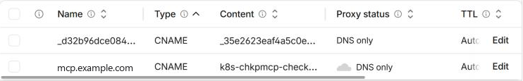

# Runbook: serve the stack on your own domain

By default the ALB serves a self-signed certificate on its AWS hostname. That works for the CLI, curl and scripts that can trust a CA file. Some clients cannot skip the certificate check at all, such as desktop MCP apps and n8n's MCP node. They need a publicly trusted certificate, which needs a domain you control.

## Deploy with a domain

```bash
python -m chkpmcpeks deploy --domain mcp.example.com
```

The domain is remembered for later deploys. To go back to the self-signed certificate, run `deploy --domain none`.

`deploy` requests a DNS-validated ACM certificate. It keeps the self-signed certificate too, so the switch never leaves the listener without one.

## DNS records

**Route 53.** If the domain's hosted zone is in the same account, `deploy` creates both records itself.

**Any other DNS provider, such as Cloudflare.** `deploy` prints two records marked `ACTION` and waits up to 30 minutes for each:

1. A `CNAME` that proves you own the domain, so ACM can issue the certificate. Keep it in place: ACM uses it to renew, and later deploys of the same domain reuse it.
2. A `CNAME` from your domain to the ALB hostname. On Cloudflare, set it to **DNS only**, not proxied, so TLS ends at the ALB with the ACM certificate.



If the wait times out, add the records and run `deploy` again. Every step converges.

## Things to know

- **The ALB hostname changes on every fresh deploy.** After a `destroy` and a new `deploy`, update the second `CNAME` to the new ALB hostname. `deploy` prints it and waits for the change. The validation record does not change.
- **After `destroy`, the domain's `CNAME` points at a deleted load balancer.** Remove it, or leave it to be updated by the next deploy.
- **Clients reach the gateway at** `https://<your-domain>/mcp` and the agent at `https://<your-domain>/v1/chat`. `python -m chkpmcpeks endpoints` prints the domain URLs once it is set.
