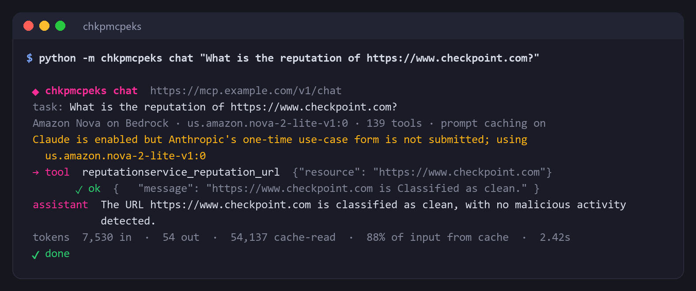
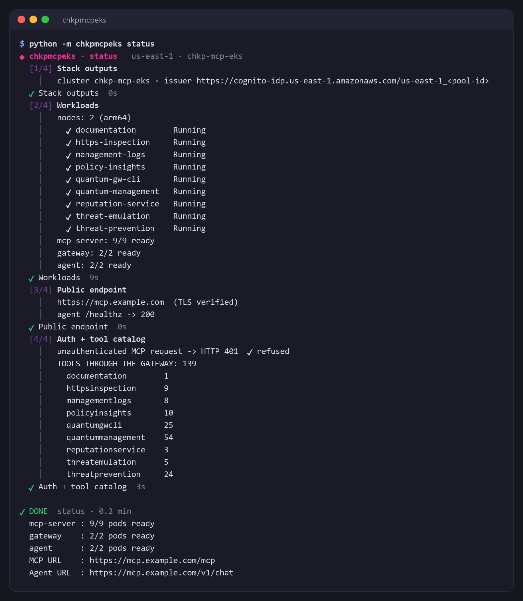
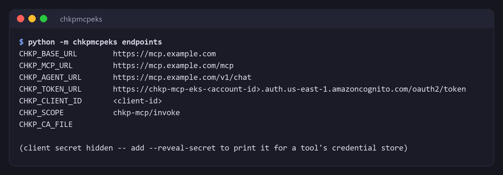

# Example: the `chkpmcpeks` CLI

The CLI mints its own Cognito token and trusts the stack's certificate automatically.

## Ask the agent

```bash
python -m chkpmcpeks chat "what is the reputation of https://www.checkpoint.com?"
```

The output looks like this. The model is Amazon Nova until Anthropic's Bedrock use-case form is approved, after which the agent switches to Claude automatically.



More questions, as many as you like:

```bash
python -m chkpmcpeks chat "is the file hash 44d88612fea8a8f36de82e1278abb02f known to be malicious?"
```

```bash
python -m chkpmcpeks chat "how do I configure HTTPS inspection on a Quantum gateway?"
```

The second question is answered by the `documentation` server.

```bash
python -m chkpmcpeks chat "how many hosts are configured, and what access layers exist?"
```

That one needs management-server credentials. See [credentials](../../docs/runbooks/credentials.md).

Force a specific model:

```bash
python -m chkpmcpeks chat --model us.amazon.nova-micro-v1:0 "what is the reputation of 8.8.8.8?"
```

Before the ALB is ready, or from inside a locked-down network, reach the agent through the Kubernetes API instead:

```bash
python -m chkpmcpeks chat --port-forward "what is the reputation of 8.8.8.8?"
```

## Inspect the stack

```bash
python -m chkpmcpeks status
```

This lists every pod, confirms an unauthenticated request is refused, and prints the tool catalog per server, fetched through the gateway.

## Check the stack

```bash
python -m chkpmcpeks status
```

It checks the pods, the public endpoint and its certificate, that an unauthenticated request is refused, and lists the tools each server exposes through the gateway.



## Endpoint values for other tools

```bash
python -m chkpmcpeks endpoints
```



